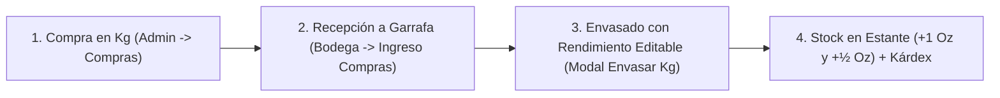

# Manual de Operación: Compra de Esencias en Kg y Envasado (Onzas y ½ Onzas)

Este documento describe el flujo completo para registrar la compra de esencias a granel en **Kilogramos (Kg)**, recibirlas en **Garrafa (Bodega)** y posteriormente **Envasarlas / Fraccionarlas** en presentaciones de **1 Onza (`1 Oz`)** y **Media Onza (`½ Oz`)** con rendimiento modificable.

---

## 1. Resumen del Flujo Operativo

---

## 2. Paso a Paso en el Sistema

### Paso 1: Registrar la Factura de Compra en Kg
1. Ingresa a **Administración (`/admin`) → Compras & Proveedores → Registrar Factura de Compra**.
2. Selecciona el proveedor y llena los datos del comprobante (CCF / Factura).
3. En la tabla de productos, al buscar y seleccionar una **Esencia**, el sistema seleccionará automáticamente la unidad **`Kg`**.
4. Ingresa cuántos **Kg** compraste (ej. `1 Kg` o `2 Kg`) y el **Costo por Kg** (ej. `\$45.00`).
   - *Nota:* El sistema guardará ese valor como `Costo por Kg` y estimará el costo por onza sin alterar ni inflar por error el costo unitario de `1 Oz`.
5. Haz clic en **Guardar Compra**. La compra quedará como **🟡 Pendiente de Bodega**.

---

### Paso 2: Confrontar y Recibir los Kg en Bodega (Ingreso a Garrafa)
1. Ingresa a **Bodega (`/bodega`) → Pestaña «Ingreso de Compras»**.
2. En la tarjeta de la compra pendiente, haz clic en **«Confrontar y Recibir»**.
3. Verifica la cantidad física recibida en **Kg** (puedes usar el botón **«Verificar Todo (100% Coincide)»**) y haz clic en **«Confirmar y Aplicar Ingreso a Bodega»**.
4. **Resultado inmediato:**
   - Los kilos recibidos se suman a **`🛢️ Garrafa (stockKg)`** de esa esencia (ej. `🛢️ Garrafa: 1 Kg`), indicando que el aceite ya está en bodega pero **aún no ha sido envasado en frascos de venta**.
   - El **Kárdex General** registra: *"🛢️ Confrontado y recibido en Garrafa: +1 Kg (Pendiente de envasar)"*.

---

### Paso 3: Envasar / Fraccionar los Kg en Onzas (`1 Oz`) y Medias Onzas (`½ Oz`)
Cuando el personal termine de envasar física o parcialmente una garrafa:

1. Entra a cualquiera de estos 3 módulos:
   - **Bodega (`/bodega`) → Pestaña «Inventario»**
   - **Administración (`/admin`) → Pestaña «Catálogo»**
   - **Inventario (`/inventario`)**
2. Verás en la esencia la etiqueta **`🛢️ Garrafa: 1 Kg`** y el botón **`🧪 Envasar`** (o el botón superior **`🧪 Envasar Kg`**).
3. Al abrir el modal **«Envasado de Esencia (Kg a Onzas y ½ Onzas)»**:
   - **Kg a Envasar Hoy:** Por defecto aparece lo disponible en garrafa (ej. `1 Kg`). Si de una garrafa de `2 Kg` hoy solo envasaron `0.5 Kg` o `1 Kg`, cámbialo a esa cantidad.
   - **Rendimiento Estimado vs Real (100% Modificable):**
     - Al poner `1 Kg`, el sistema sugiere automáticamente la estimación base: **`32` Onzas (`1 Oz`)** y **`8` Medias Onzas (`½ Oz`)** (`36.0 oz equivalentes`).
     - Como cada esencia tiene diferente densidad/viscosidad, **modifica libremente ambos campos** con lo que salió en realidad (por ejemplo: **`31` de 1 Oz** y **`9` de ½ Oz** = `35.5 oz efectivas`, o **`33` y `5`**).
   - **Puesto / Estante:** Verifica o escribe el estante donde se colocaron (ej. `B6`, `B7`).
   - *(Opcional)* Marca **«Guardar este rendimiento como nueva estimación predeterminada para esta esencia»** si quieres que la próxima vez que envases ese perfume te sugiera de entrada esos mismos números.
4. Haz clic en **«Confirmar Envasado»**.
5. **Resultado inmediato:**
   - Se descuenta el kilo envasado de **`🛢️ Garrafa`**.
   - Se suman las unidades reales a **`Stock 1 Oz`** y **`Stock ½ Oz`**.
   - Se actualiza el **costo real por onza** según el rendimiento obtenido ($\text{Costo Kg} \div \text{Onzas efectivas}$).
   - Queda registrado el detalle completo en el **Kárdex General**.

---

## 3. Casos Especiales Soportados

| Caso | Cómo actuar en el modal «🧪 Envasar Kg» |
| :--- | :--- |
| **Envasado parcial** (compraste 2 Kg pero solo envasaste 1 Kg hoy) | Pon `1 Kg` en *Kg a Envasar Hoy*. El sistema restará `1 Kg` de garrafa (quedando `1 Kg` pendiente) y sumará las onzas obtenidas. |
| **Solo envasaste frascos de 1 Oz** (sin medias onzas) | Pon la cantidad total en **Onzas Completas (`1 Oz`)** (ej. `35`) y pon **`0`** en **Medias Onzas (`½ Oz`)**. |
| **Envasado directo sin compra previa en sistema** (`Garrafa: 0 Kg`) | Abre **«🧪 Envasar Kg»**, pon `1 Kg` y las onzas obtenidas. El sistema sumará las onzas al estante y mantendrá la garrafa en `0 Kg` sin bloquear el proceso. |
